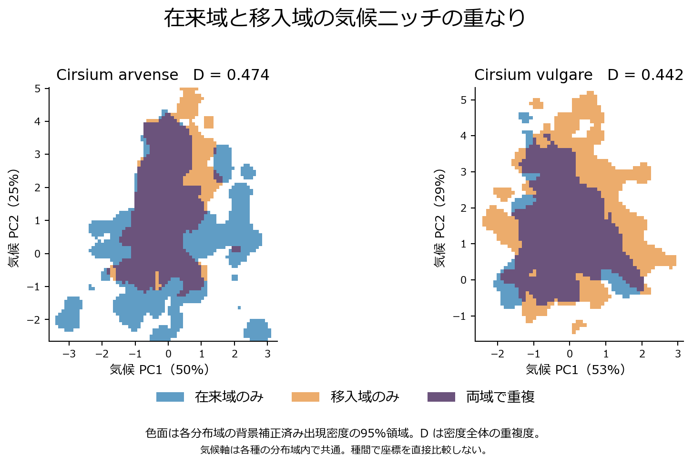
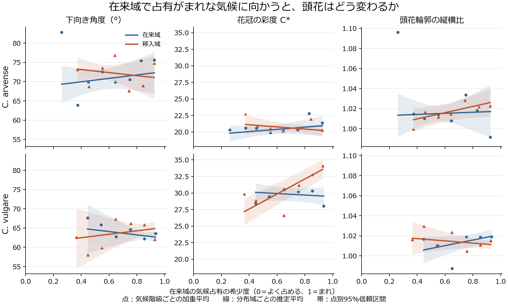

# V5　気候と頭花の対応を、在来域と移入域で調べる

## Ⅰ　在来域で、似た気候の地点に似た頭花があるか

**1　似た気候の地点ほど、頭花の組合せも似ていた。** 在来域の適格写真157,822枚から、分類群ごと・地理セルごとに頭花の向き、花冠彩度C*、画像輪郭の縦横比を集約した。年平均気温・年降水量・短波日射で似た地点を選ぶと、3形質を合わせた距離が置換から期待されるより小さかった。分類群内でも分類群間でも1°・5°の両粒度で見られた。気温と降水の季節性を加えた同一標本での比較では、分類群内は両粒度で明瞭だった。分類群間は5°で明瞭（補正P=.012）、1°では同方向で不確かだった（.076）。この類似には地理や共通祖先の影響も含みうる。[距離の比較と季節性の検証](native_seasonality/RESULTS_JA.md)

**2　多雨側の地点ほど、頭花が下向きに写った。** 異なる分類群の地点を対にし、分類群ペアの平均差を取り除いても、年降水量と下向き角度の標準化係数は1°で+.160、5°で+.170だった。季節性追加後も+.117［.015, .220］、+.183［.022, .339］だった。区間は点別95%。雨からの保護という仮説に沿う方向だが、写真から花粉保護や結実への効果は測れない。[降水と頭花角度の係数](native_seasonality/v5_signed_pairs_seasonal.csv)

同じ分類群ペアの平均差を除いた地点比較では、季節性を含む5変数×3形質のうち、降水と向きのほかに**降水の季節差が大きい側ほど花冠彩度C*が高い**という対応が両粒度で見られた（1°の標準化係数+.206［.067, .348］、5°は+.226［.046, .375］）。年降水量・年平均気温・日射・気温季節性を同時に考慮した係数。各係数の点別95%区間に基づく探索的な所見で、1°と5°には同じ写真が含まれる。輪郭について同じ条件を満たす気候変数はなかった。[全形質・全気候軸の係数](native_seasonality/v5_signed_pairs_seasonal.csv)

## Ⅱ　移入先で占める気候が広がると、どの頭花形質がずれるか

**1　どんな気候に広がったか。** 広域分布する2種を別々に扱い、各種の在来域全体を基準に移入域全体を比べた。気候はⅠの3変数に気温・降水の季節性を加えた5変数、標高なし。在来と移入の背景気候から作った共通の主成分2軸上で、利用可能な気候面積で補正した占有密度を重ねた。

| 種 | 在来・移入の気候占有の重なり D | 移入先の占有密度のうち在来主要95%域の外 |
|---|---:|---:|
| *C. arvense* | 0.474 | 18.8% |
| *C. vulgare* | 0.442 | 44.0% |

Dは0で重なりなし、1で同じ分布。右列は移入域全体の補正済み密度を分母とする。下の気候値は移入先の頭花測定済み1°セルを等重みで集約した中央値で、占有密度の割合とは分母が異なる。

*C. arvense* では、移入先のうち在来主要域の外側32セルは、内側828セルより概して温暖・多雨だった（年平均12.1対6.7°C、年降水1,482対778 mm）。一方、*C. vulgare* の外側201セルは内側938セルより概して冷涼・少雨で（8.7対10.4°C、697対898 mm）、降水季節性BIO15の中央値は60.5対30.1だった。各種の外側にも異なる気候の組合せが含まれる。[両種の気候中央値](expansion_consistency/main_climate_profiles.csv)

**2　その広がりに沿って何がずれ、在来域でも同じ傾向があるか。** 在来域でよく占める気候からまれに占める気候までを連続量で表した。両域に利用可能な背景気候で、移入側の1°セルにおける向き・C*・輪郭の勾配を推定した。次に、両域が実際に占める気候階級の頻度をそろえ、在来・移入の傾きの差を直接検定した。図の点は希少度を0.1刻みでまとめた加重平均（5セル以上）、線と帯は連続勾配の推定と20°空間ブロックによる点別95%区間。[元データからの再計算](https://github.com/zuizui0223/azami/actions/runs/42603157015)

*C. vulgare* では、在来域でまれな気候に向かうほど移入先の花冠が高彩度だった（1,023セル、希少度0.1当たり+.76 C*［+.34, +1.19］、Holm補正P=.0092）。同じ気候階級の頻度にそろえても、希少度1 SD当たりの標準化彩度勾配は在来−.016、移入+.159、差+.175［+.111, +.239］だった。向き・輪郭には同様の域間差は明瞭でなかった。*C. arvense* では移入域850セルで特定の形質の勾配は明瞭でなく、3形質のいずれにも補正後に域間差は見られなかった。[2種の係数・区間・標本数](expansion_consistency/RESULTS_JA.md)

移入先の新しい気候で、頭花全体の分布が大きく入れ替わった証拠は乏しい。共通背景で在来主要気候域を外れた移入セルでも、在来域との3形質分布の重なりDは *C. arvense* .731、*C. vulgare* .791だった。今回捉えたのは *C. vulgare* の彩度と気候との対応が移入域で強いことまでである。導入元集団、遺伝性、可塑性、繁殖適応度を区別する観察は含まれていない。[頭花分布の重なり](invasion_design/availability_heads.csv)

### 補足

少雨・降水季節差大に限定した比較、各気候変数の係数、過去のモデルは補足にまとめた。今回の二部構成は既存結果を検討した後の探索的整理である。[降水条件をそろえた比較](vulgare_rain/RESULTS_JA.md)・[全域の気候と彩度の図](vulgare_climate/RESULTS_JA.md)・[以前の結果と解析一覧](RESULTS_PRIOR_JA.md)
